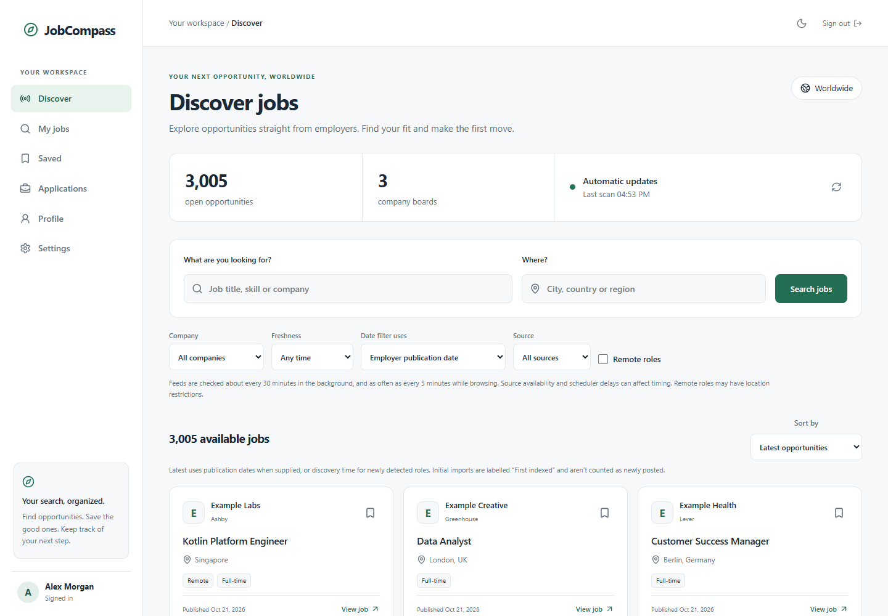

# JobCompass

**A clearer place for your job search.**

Discover opportunities from employer boards, build a shortlist, prepare application materials and track progress in a personal workspace.

**JobCompass never submits applications for you. You review and submit every application yourself.**

[Features](#features) · [Local setup](#local-setup) · [Architecture](docs/architecture.md) · [Detailed guide](docs/PROJECT_GUIDE.md) · [Contributing](CONTRIBUTING.md) · [Security](SECURITY.md)



## Features

| Stage | Workspace capability |
| --- | --- |
| Discover | Employer-board catalogue, filtering, personal matching and optional single-board import |
| Shortlist | Saved roles, private notes, tags, and skip/restore controls |
| Prepare | Original CV handling, structural checks, keyword evidence and reviewed tailored documents |
| Apply | Owner-preview companion that fills supported forms; you review and press Submit yourself |
| Track | Application stages, dates, notes, event history and recovery information |

The product distinguishes jobs merely opened on an employer site from applications actually submitted. Private account data is scoped to its owner.

## What is available

**Core workspace:** employer feeds from Greenhouse, Lever, Ashby, Workable and Recruitee; discovery; saved jobs; application tracking; and hosted account sessions.

**Optional previews:** personal-key AI (evidence-quoted reviews, a "Should I apply?" verdict and tailored CVs), guided application preparation, swipe matching and browser-assisted form filling (never submission). These features have separate access controls and configuration. They are not universally enabled for every account. See the [detailed project guide](docs/PROJECT_GUIDE.md) for limits, rollout flags and operational behavior.

The current hosted deployment is an owner workspace. The public source code does not grant access to that deployment or its data.

## Stack

| Layer | Technology |
| --- | --- |
| Application | Next.js, React and TypeScript |
| Data | PostgreSQL and Prisma |
| Authentication | Better Auth and database sessions |
| Interface | CSS, Tailwind and Lucide |
| Verification | Node fixtures, database integration checks and Playwright/Chrome |

Versions are pinned in [package.json](package.json) and the lockfile.

## Local setup

Use **Node.js 24**, npm and local PostgreSQL, or the bundled development database helper.

```sh
npm ci
cp .env.example .env
npm run db:generate
```

In PowerShell, use `Copy-Item .env.example .env` in place of `cp`, and `npm.cmd` if execution policy blocks `npm`.

Start the bundled database in one terminal:

```sh
npm run db:start
```

In a second terminal:

```sh
npm run db:migrate
npm run dev
```

Open **http://127.0.0.1:3000/discover**. Local development uses loopback-only settings; hosted accounts require separate configuration. Keep production databases out of local test commands.

## Verification

```sh
npm run lint
npm test
npm run test:migration
npm run build
npm run typecheck
```

Browser acceptance checks require a built app, Chrome and the dedicated test environment:

```sh
npm run test:browser
npm run test:filling
npm run test:workspace
```

The [detailed guide](docs/PROJECT_GUIDE.md#verification) preserves the previously recorded local test counts and their scope. Those historical results are not a claim that the checks ran again for this README update.

## Architecture and project map

| Location | Responsibility |
| --- | --- |
| [src/app](src/app) | Application routes and API handlers |
| [src/components/workspace](src/components/workspace) | Product interface |
| [src/lib](src/lib) | Discovery, matching, CV processing, authorization and data access |
| [prisma](prisma) | Schema and migrations |
| [tests](tests) | Contract and database test fixtures |
| [scripts](scripts) | Development, catalogue maintenance and browser verification |

Read [architecture](docs/architecture.md) for data flows and account boundaries.

## Documentation

- [Full project and operations guide](docs/PROJECT_GUIDE.md): detailed behavior, configuration, feed scheduling and storage bounds.
- [Discovery](docs/discovery.md) and [catalogue provenance](docs/catalog-candidates.md).
- [CV checks and benchmark limits](docs/ats-benchmark.md).
- [Personal-key AI](docs/personal-ai.md) and [application memory](docs/application-memory.md).
- [Application filling](docs/application-filling.md) and [filling/recovery](docs/application-reliability.md).
- [Swipe matching](docs/swipe-matching.md).

## Access and limits

No open-source licence has been chosen yet; until a `LICENSE` file is added, default copyright applies. Credentials, CVs, browser sessions and production data belong outside commits; run `npm run check:secrets` before pushing.

Employer feed coverage and polling are bounded. Missing source data remains unknown, and remote roles do not imply worldwide eligibility. CV checks describe observable document and keyword findings rather than a guaranteed employer ATS outcome. See the linked guides for the implementation's detailed limits.
