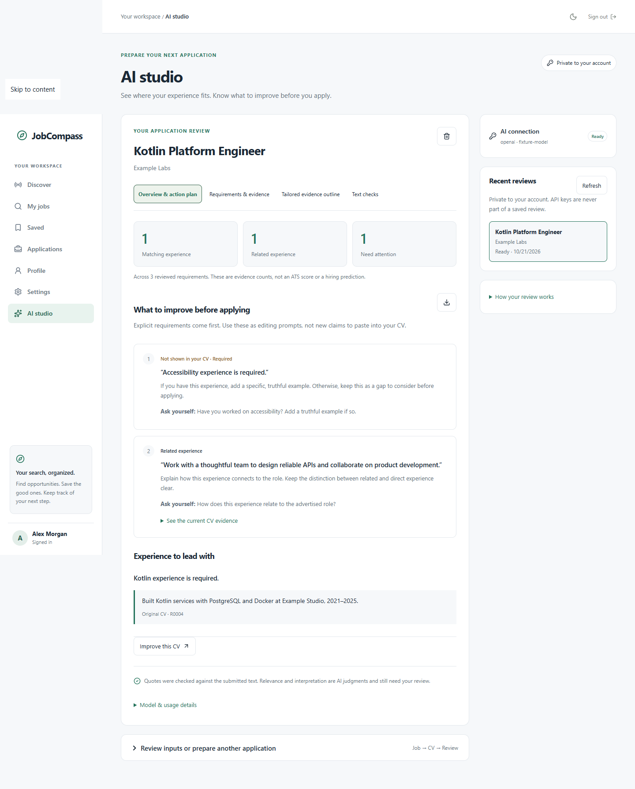

# Optional personal-key AI

The AI studio compares one résumé with one selected catalogue or private job. It combines free deterministic text/keyword checks with an explicit, user-paid structured model request. Model calls use the user's chosen OpenAI, Google Gemini, Anthropic or OpenRouter key. There is no shared key or AI Gateway fallback.

## Application workflow

The studio now uses a persistent application queue and five URL-addressable steps: **Job → Your CV → Review → Tailored CV → Apply**. Job selection uses a searchable list, provider settings open in an accessible native dialog, and tailored documents have their own destination. The selected role/company stays in the context header and the step navigation stays visible while scrolling. Opening an existing review restores its source job and CV snapshot.

The final step links the original CV, tailored document workspace, employer form and tracked application. Following the employer link starts private preparation; it never confirms submission. The user can also save preparation without opening the form. An explicit “I’ve submitted my application” action records a manual Applied event and timestamp. Repeating that action preserves the original timestamp without duplicating the event. Existing application progress is preserved. All operations use the current account and AI access policy, make no model requests, and leave the legacy auto-fill/companion disabled.

The studio starts with the selected job and the user's saved CV. Job switching, free text diagnostics, provider connection details, and history use progressive disclosure. Provider settings remain in a secondary panel; connecting or loading model IDs never starts a review. The primary action explains which input or confirmation is still needed. During generation, an elapsed timer shows actual waiting time without inventing a completion percentage or retrying the request.

Completed and historical reviews open with evidence counts and a prioritized action plan, followed by matching experience. Required requirements appear first in the action plan; related experience and missing evidence remain distinct. Users can filter the requirement evidence, download the application review, inspect the original excerpts in a conventional outline, and restore a review's exact CV and job for editing. Restoring inputs clears approval and provider-usage consent, and sends no AI request. These views use the existing grounded report, so opening tabs, downloading or improving the input never consumes another provider call. Counts summarize the reviewed requirements, not the entire posting or an ATS score.

## Full tailored CV drafts

### Original Word layout and ATS readiness

Upload a DOCX in **Your CV** to use it as the source template. Original-format generation edits supported wording inside existing paragraphs instead of rebuilding the document. The exporter retains the original styles, paragraph/run formatting, margins, headers, footers and other ZIP parts. Review the saved document preview, compare paragraph changes, edit wording, save and confirm the exact revision before downloading. Longer text and unavailable fonts can change pagination; check the final file in Word. A separate clean-layout option remains available for pasted text and PDF sources.

DOCX originals are retained privately as account-scoped `ResumeAsset` records, with a source hash linked to the review. A matching original can be attached to an older review without regenerating the review. Only an explicit saved-CV checkbox updates the profile used for future applications and recommendations. Source previews, ATS checks, edits and downloads make no provider requests. Profile clearing removes stored source files alongside reviews and drafts; workspace export includes the account's stored résumé data.

The ATS readiness panel combines extractable-text/keyword checks with structural findings for tables, columns, graphics, textboxes, header/footer contact details, tracked or hidden text, and file size. These are review prompts informed by [Greenhouse's documented parsing limitations](https://support.greenhouse.io/hc/en-us/articles/200989175-Unsuccessful-resume-parse), not a universal ATS certification or employer score. Preserving a source layout also preserves its risks; the app flags them rather than silently redesigning the CV. Browser previews run inside a sandboxed iframe with external requests and scripts blocked. Macros, embedded objects and unsafe relationships are rejected on upload.

Open **Tailored CV** on a completed review and explicitly approve a separate provider request. The selected saved connection is reused. The model rewrites a professional summary and supported bullets, organizes conventional sections, and cites original CV blocks for each paragraph. Name, contact and role/qualification context blocks are copied from the original snapshot. The saved profile is never overwritten.

Each generation creates a private version linked to the review. Preview, edit the complete CV, compare generated wording with sources, and save edits without another AI call. Word and text downloads require confirmation of the exact saved revision; edits clear confirmation and concurrent edits are rejected. Word export uses a single-column A4 layout with conventional headings and no tables, images, external relationships or macros. This does not guarantee compatibility with every employer's ATS.

Source IDs, unsupported numbers and recognized added skills are checked server-side. These guards do not prove semantic correctness, completeness, chronology or that a claim preserves its original level of responsibility. The user must check employers, roles, dates, qualifications, metrics and wording before using a draft. Failed checks reject the generated draft without automatic retry; any reported usage is retained.

Reviews and CV generations share the same daily attempt allowance, per-account pending-request lock, timeout and idempotency protections. Failed and uncertain generations remain counted. Opening tabs, saving edits and downloading do not generate text. Deleting a parent review cascades to its CV versions; workspace export includes the user's drafts and profile clearing removes them. Disabling `AI_MODE` also disables CV routes. Implementation lives in `src/lib/tailored-cv*`, `TailoredCv.tsx`, and the private CV API routes, alongside the existing AI module.

## Access and removal

Set `AI_MODE` in the **production** Vercel environment and redeploy:

| Value          | Behaviour                                                                                                                      |
| -------------- | ------------------------------------------------------------------------------------------------------------------------------ |
| `off` or unset | Hide AI navigation, settings and job links; refuse AI operations server-side; the studio page is unavailable.                  |
| `owner`        | Only the signed-in account matching `OWNER_EMAIL` can use the studio. All other accounts retain normal discovery and tracking. |
| `byok`         | All signed-in accounts can use their own API key. No user can invoke someone else's stored review.                             |

The initial release uses `owner`. Keep `ENABLE_AI=false`: that older flag controls the separate legacy gateway/companion implementation, which stays disabled. The new module does not enable employer form filling or submissions.

Turning the mode off preserves jobs and review history. Users can still export their own stored reviews through workspace export, or remove them with profile clearing. To delete code entirely, the new feature lives in `src/lib/personal-ai*`, `src/lib/resume-*`, `src/lib/ai-access.ts`, `src/app/api/ai`, the assistant page, and its context/UI/CSS. Remove the small navigation/settings/job-link integrations at the same time; keep the database table if historical exports are needed. Reverting the additive migration is not required to disable AI.

## Key handling and data flow

1. A user enters a provider key into the AI studio. “Save connection” stores it using AES-256-GCM encryption in a private `AiConnection` row and remembers the provider/model. The server uses a dedicated `PERSONAL_AI_ENCRYPTION_KEY` (32 random bytes encoded as 64 hex characters), with authentication bound to the workspace and provider. Only non-secret connection metadata is returned to the browser. Alternatively, “Use for this tab only” keeps an unsaved key in React state until refresh or sign-out. Neither mode puts plaintext keys in browser storage, cookies, exports or logs.
2. Loading model IDs explicitly sends the key to the selected provider's fixed HTTPS models endpoint. It does not request inference. Results appear in a visible “Available models” select with a loaded count, empty state and inline errors. An exact ID can also be entered manually. Refresh and sign-in restore a saved selection without requiring model discovery again. Model availability and structured-output support depend on the provider account.
3. The user selects a real job and reviews pasted, saved or extracted résumé text. PDF/DOCX import is limited to 3 MB and PDFs to 40 pages, using the maintained PDF.js-based `unpdf` extractor without font rendering. PDF import extracts text without retaining the uploaded file; DOCX originals are stored privately for template-preserving edits and previews. Import makes no AI request. Image-only PDFs need separate OCR. Literal symbols are preserved in the editable text preview.
4. After the user confirms the text and provider usage, the server sends the résumé blocks and job text to that provider. Saved keys are decrypted only on the server for the account's selected provider. Redirects and arbitrary endpoints are refused. No tools, remote-image fetches, web search, provider failover or automatic retries are enabled. OpenAI Responses requests set `store:false`; the provider's own data and billing policies still apply.
5. The report, source snapshots, provider/model IDs, usage where available, and safe error codes are stored in the user's workspace. Prompt credentials, raw provider errors and transport request bodies are not stored or logged. Users can delete individual completed reviews, clear reviews with their profile or export their own records.

There is no automatic billable connection test. Generating a review is an explicit action, never a side effect of discovery or profile saving. `BYOK_DAILY_LIMIT` defaults to 20 attempts per account per UTC day, including failed or uncertain attempts. A shared per-account lock permits only one pending review. Replays of the same request key cannot dispatch twice. Uncertain requests are not retried; a user must deliberately start a new request, which may incur another charge.

“Forget key” deletes the account connection; profile clearing also removes it. Connection ciphertext is excluded from workspace exports and reports. Keep the production encryption secret stable and protected separately from the database; replacing it makes existing saved keys unreadable and users must reconnect. Without this environment secret, saving is refused and the unsaved tab-only flow remains available. Do not put the secret in any `NEXT_PUBLIC_` variable or expose it to preview environments sharing production data.

Provider requests have a four-minute deadline. The review route allows 300 seconds, leaving time for reservation, validation and persistence. Pending reviews become interrupted only after 330 seconds, so reading history in another tab cannot expire a legitimately running request. The studio displays the expected wait while generating. An earlier release stopped requests after 65 seconds; existing uncertain records remain unchanged and are never automatically replayed. A timeout does not establish whether the provider charged for its work.

## Accuracy boundaries

- Text diagnostics are heuristics: extractable words, email-shaped text, standard English headings, length and replacement characters. DOCX structural checks additionally flag columns and other parsing risks, but cannot establish an employer's reading order or parser behavior. PDF structure and final Word pagination are not certified. Review the text and document previews.
- Keyword coverage uses explicit word boundaries and a small, documented vocabulary across several fields. Java and JavaScript remain distinct. Presence means a word was mentioned, not proficiency. Missing words do not establish a missing qualification.
- AI requirements must quote the actual job text. Candidate evidence must cite a real numbered résumé block and an exact substring. Invalid requirement citations are removed, the affected requirement is marked unclear, its clarification question is replaced with a source-check prompt, and the report discloses the omission count. Verified parts remain useful without another provider request. Invalid job quotes, duplicate requirements/sections and unverifiable outline excerpts still reject the report; no invalid quote can enter the downloadable CV outline.
- Obvious keyword mismatches and unconfirmed numeric experience durations cannot remain labelled as explicit support. Other relevance decisions, priorities, inferred transferability and clarification questions remain AI judgments requiring human review.
- The tailored outline selects and reorders original excerpts. It is not a rewritten or complete résumé. Users must preserve context, employers, dates, chronology and relevant omitted material before using it. No skill or achievement is inserted merely because the employer asks for it.
- There is no ATS pass score, hiring probability or interview guarantee.

## Verification

Integration tests exercise all four SDK adapters with simulated provider HTTP responses, grounding failures, key redaction, concurrency, request replays, quotas, actual owner/non-owner sessions, private exports and deletion. Browser acceptance tests preload `scripts/ai-browser-fixture.mjs` only in the isolated fixture database, exercising the real studio → API → SDK → validation → database flow without contacting a live model provider. The fixture module refuses Vercel and non-test databases and is never imported by application code.

A real paid model call still requires a user to enter their own valid key and choose an available structured-output model in the app. Tests do not spend a user's API credits.
